# DogsWorld

Contoh lengkap aplikasi CRUD di Kubernetes (minikube) yang dipantau **Datadog APM tanpa mengubah kode aplikasi**, memakai **Single Step Instrumentation (SSI)**. Satu script menyiapkan seluruh lingkungan di laptop kamu, lalu kamu bisa memanggil API dan melihat trace-nya muncul di Datadog.



## Yang kamu dapat

- Dua aplikasi dengan API yang sama: **.NET Core 3.1** (ASP.NET dan EF Core) dan **Node 20** (Express dan `pg`).
- **PostgreSQL 16** yang dipakai bersama oleh kedua aplikasi, sudah berisi 9 data contoh.
- **Datadog Operator, Agent, dan Cluster Agent**. Cluster Agent menyuntikkan tracer ke pod aplikasi lewat SSI, jadi Dockerfile tidak berisi tracer apa pun.
- Swagger UI di setiap aplikasi untuk mencoba API.
- Image siap pakai di GHCR (multi-arch: amd64 dan arm64), jadi kamu tidak perlu build sendiri.

Datadog bersifat opsional. Tanpa akun Datadog, jalankan script dengan `-NoDatadog` (PowerShell) atau `--no-datadog` (bash), dan aplikasi tetap berjalan.

## Prasyarat

| Kebutuhan | Keterangan |
|---|---|
| Sistem operasi | Windows (PowerShell), macOS, atau Linux (bash) |
| Podman atau Docker | Diuji dengan Podman 6.1.4. Di Windows, Podman memakai VM WSL dalam mode rootful |
| minikube | Diuji dengan 1.39.0 |
| kubectl | Versi terbaru yang kompatibel dengan minikube |
| Helm | Diuji dengan 4.3.1 |
| Akun Datadog dan API key | Hanya jika kamu ingin melihat trace. Site apa pun didukung, misalnya `datadoghq.com` atau `ap1.datadoghq.com` |
| Sumber daya | 4 CPU dan sekitar 5,5 GB RAM kosong untuk seluruh cluster. Tutup aplikasi berat sebelum mulai |

Status pengujian: jalur Windows sudah dijalankan penuh. Script macOS dan Linux sudah lolos pengecekan sintaks, tetapi belum diuji penuh di Mac Apple Silicon. Laporkan masalah lewat issue di GitHub.

Di PowerShell yang baru dibuka, PATH kadang belum diperbarui. Jalankan ini dulu:

```powershell
$env:Path = [System.Environment]::GetEnvironmentVariable("Path","Machine") + ";" + [System.Environment]::GetEnvironmentVariable("Path","User")
```

## Mulai cepat

```bash
git clone https://github.com/bongcoy/dogsworld-minikube.git
cd dogsworld-minikube
```

Script menyiapkan cluster, Operator, Agent, PostgreSQL, user untuk Database Monitoring, dan kedua aplikasi.

Windows (PowerShell):

```powershell
.\scripts\setup.ps1
# atau tanpa pertanyaan:
.\scripts\setup.ps1 -Site ap1.datadoghq.com -Env alice -ClusterName dogsworld-alice
```

macOS atau Linux:

```bash
./scripts/setup.sh
# atau tanpa pertanyaan:
./scripts/setup.sh --site ap1.datadoghq.com --env alice --cluster-name dogsworld-alice
```

Script akan menanyakan empat hal:

| Pilihan | Arti |
|---|---|
| site | Site Datadog milikmu, misalnya `ap1.datadoghq.com`, `datadoghq.com`, atau `us5.datadoghq.com` |
| API key | Dari org Datadog milikmu. Diketik tersembunyi atau dibaca dari env `DD_API_KEY`. Hanya disimpan di Secret Kubernetes, tidak ditulis ke file atau log |
| env | Tag `env` pada data Datadog, misalnya namamu. Huruf kecil (lihat [`TAGS.md`](TAGS.md)) |
| clusterName | Nama cluster di Datadog. Pakai nama unik per orang jika beberapa orang berbagi satu org |

Opsi lain (sama di kedua script):

| PowerShell | Bash | Fungsi |
|---|---|---|
| `-NoDatadog` | `--no-datadog` | Hanya aplikasi dan PostgreSQL, tanpa Datadog |
| `-SkipCluster` | `--skip-cluster` | Pakai cluster yang sudah jalan (context `kubectl` aktif) |
| `-LocalImages` | `--local-images` | Build image dari `apps/` dan muat ke minikube, tanpa menarik dari GHCR |
| `-OperatorVersion` | `--operator-version` | Versi chart Operator (default `2.30.0`) |
| `-Driver` | `--driver` | Driver minikube (default `podman`, bisa `docker`) |
| `-Cpus`, `-MemoryMb` | `--cpus`, `--memory-mb` | Sumber daya cluster (default 4 CPU dan 4096 MB) |

Script aman dijalankan ulang. Secret yang sudah ada (`datadog-secret`, `postgres-secret`, `datadog-pg-secret`) tidak ditimpa. Password database dibuat acak dan hanya ada di Secret.

## Coba aplikasinya

Jalankan dua perintah ini di terminal terpisah. Port-forward berhenti kalau terminal ditutup, pod dibuat ulang, atau minikube dihentikan.

```bash
kubectl port-forward svc/dogsworld-dotnet 8080:80 -n dogsworld
kubectl port-forward svc/dogsworld-js 8081:80 -n dogsworld
```

| Aplikasi | Swagger UI |
|---|---|
| .NET | http://localhost:8080/swagger/index.html |
| Node (JS) | http://localhost:8081/swagger/index.html |

Contoh dari terminal:

```bash
curl http://localhost:8081/api/dogs
curl -X POST http://localhost:8081/api/dogs \
  -H "Content-Type: application/json" \
  -d '{"name":"Rex","breed":"Labrador","age":3,"birthDate":"2023-01-15T00:00:00Z","hasOwner":true}'
```

```powershell
Invoke-RestMethod http://localhost:8081/api/dogs
Invoke-RestMethod -Method Post -Uri http://localhost:8081/api/dogs -ContentType "application/json" `
  -Body '{"name":"Rex","breed":"Labrador","age":3,"birthDate":"2023-01-15T00:00:00Z","hasOwner":true}'
```

Kedua aplikasi memakai **database yang sama**. Data yang dihapus lewat satu aplikasi juga hilang di aplikasi lain. Itu disengaja supaya kamu bisa melihat satu data dari dua service.

## Lihat hasilnya di Datadog

Panggil `/api/dogs` beberapa kali, tunggu satu atau dua menit, lalu buka Datadog:

- **APM → Services**: `dogsworld-dotnet` dan `dogsworld-js`, dengan `env` yang kamu pilih saat setup. Trace Node berisi span database dari `pg`.
- **Infrastructure → Kubernetes**: cluster dengan `clusterName` pilihanmu.

Semua data dari Agent juga membawa tag `team:bongcoy`. Ubah nilainya di `spec.global.tags` pada `k8s/datadog-agent.yaml` jika kamu ingin nama timmu sendiri (aturan tag ada di [`TAGS.md`](TAGS.md)).

### Alur satu request



Versi interaktif ada di dua file HTML. GitHub tidak menampilkannya langsung, jadi unduh repo lalu buka file ini di browser:
- [`dogsworld-architecture.html`](.archify/architecture-dogsworld-20261021-231326/dogsworld-architecture.html): arsitektur.
- [`dogsworld-request-sequence.html`](.archify/sequence-dogsworld-request-20261021-231326/dogsworld-request-sequence.html): alur satu request.

## Membersihkan

Hentikan cluster untuk membebaskan RAM (data tetap ada):

```bash
minikube stop
```

Hapus semuanya, termasuk database dan Secret:

```bash
minikube delete
```

Kalau kamu memakai cluster sendiri (`-SkipCluster`), hapus komponen DogsWorld saja:

```bash
kubectl delete namespace dogsworld
kubectl delete datadogagent datadog -n datadog
helm uninstall datadog-operator -n datadog
kubectl delete namespace datadog
```

## Mengatasi masalah

| Gejala | Penyebab dan solusi |
|---|---|
| Perintah `minikube`, `kubectl`, atau `helm` tidak ditemukan di PowerShell | PATH belum diperbarui. Jalankan perintah di bagian Prasyarat |
| Swagger menampilkan "not found" atau koneksi ditolak | Port-forward mati. Jalankan ulang perintah `kubectl port-forward` |
| Pod aplikasi berstatus `ImagePullBackOff` | Image tidak bisa ditarik dari GHCR. Jalankan ulang script dengan `-LocalImages` (`--local-images`) |
| Tracer tidak muncul di pod, atau service tidak ada di APM | Suntikan SSI hanya terjadi saat pod dibuat. Jalankan `kubectl rollout restart deployment <nama> -n dogsworld` |
| Service muncul di APM, tetapi trace sangat sedikit atau kosong | Datadog Adaptive Sampling bisa menurunkan sampling hingga 1% lewat Remote Configuration. Matikan di Datadog: APM → Setup & Configuration → Ingestion Control. Cek juga dengan `kubectl exec <pod-agent> -n datadog -c agent -- agent status`: "Traces received" besar tetapi Writer "Traces" kecil menandakan hal ini |
| Check `postgres` di Agent menampilkan error | Secret `datadog-pg-secret` atau user `datadog` belum ada. Script setup membuatnya otomatis. Pada langkah manual, lihat catatan di bagian Langkah manual |

Perintah pemeriksaan yang berguna:

```bash
minikube status
kubectl get pods -n dogsworld
kubectl get pods -n datadog
```

Semua pod yang sehat berstatus `Running`.

## Detail teknis

<details>
<summary>Struktur repo</summary>

Repo ini **monorepo**: semua aplikasi dan konfigurasi deploy-nya ada di satu repo.

```
dogsworld-minikube/
├── README.md
├── LICENSE
├── TAGS.md                 konvensi tag Datadog dan konvensi build
├── apps/
│   ├── dogsworld-dotnet/   .NET Core 3.1 (ASP.NET + EF Core)
│   └── dogsworld-js/       Node 20 (Express + pg)
├── k8s/                    manifest Kubernetes yang dipakai bersama
├── scripts/                setup.ps1, setup.sh, dbm-setup.sh, build-push.ps1
└── .archify/               diagram arsitektur dan sequence (HTML dan SVG)
```

Setiap aplikasi punya `Dockerfile` dan `.dockerignore` sendiri. Konteks build adalah folder aplikasinya.

</details>

<details>
<summary>Isi cluster</summary>

| Namespace | Komponen | Keterangan |
|---|---|---|
| `dogsworld` | `dogsworld-dotnet` (.NET) | Disuntik tracer oleh SSI |
| `dogsworld` | `dogsworld-js` (Node) | Disuntik tracer oleh SSI |
| `dogsworld` | `postgres` | PostgreSQL 16, data di PVC. Tabel dibuat lewat ConfigMap `postgres-init` hanya saat volume masih kosong. Tidak disuntik |
| `datadog` | Operator, Agent, Cluster Agent | Mengirim data ke site Datadog pilihanmu |

Service aplikasi membuka port 80 dan meneruskannya ke port kontainer 8080. Port 8080 dan 8081 di atas adalah port lokal untuk port-forward.

SSI dikonfigurasi di `k8s/datadog-agent.yaml`: target memilih namespace `dogsworld`, dan `ddTraceVersions` memilih tracer `dotnet` dan `js`.

</details>

<details>
<summary>Kontrak API</summary>

Sama untuk semua aplikasi. JSON memakai camelCase: `id` (angka), `name`, `breed`, `age` (angka), `birthDate` (tanggal ISO 8601), `hasOwner` (boolean).

| Method | Path | Hasil |
|---|---|---|
| GET | `/api/dogs` | 200, daftar dog |
| GET | `/api/dogs/{id}` | 200, atau 404 |
| POST | `/api/dogs` | 201 + header `Location` |
| PUT | `/api/dogs/{id}` | 204. 400 jika id URL tidak cocok dengan body, 404 jika tidak ada |
| DELETE | `/api/dogs/{id}` | 200 berisi dog yang dihapus, atau 404 |

Swagger UI ada di `/swagger/index.html` pada setiap aplikasi.

</details>

<details>
<summary>Langkah manual (tanpa script)</summary>

Langkah ini sama dengan yang dikerjakan script, berguna kalau kamu ingin belajar tiap bagiannya. Manifest memakai nilai bawaan: site `ap1.datadoghq.com`, `env` `dev`, dan `clusterName` `dogsworld-minikube`. Ubah nilainya di `k8s/` sebelum `kubectl apply` kalau kamu memakai nilai lain.

**1. Cluster**

```powershell
minikube start --driver=podman --container-runtime=cri-o --cpus=4 --memory=4096
kubectl get nodes
```

**2. Datadog Operator dan Agent**

```powershell
helm repo add datadog https://helm.datadoghq.com
helm repo update
helm install datadog-operator datadog/datadog-operator -n datadog --create-namespace
```

Buat Secret API key sendiri. Ganti `<API_KEY>` dengan key kamu, dan jangan menempelkannya ke file, chat, atau log.

```powershell
kubectl create secret generic datadog-secret -n datadog --from-literal api-key=<API_KEY>
kubectl apply -f k8s/datadog-agent.yaml
kubectl get pods -n datadog
```

Catatan: manifest Agent juga mengaktifkan Database Monitoring untuk PostgreSQL. Langkahnya (user `datadog`, Secret `datadog-pg-secret`, `k8s/datadog-dbm-rbac.yaml`, dan `scripts/dbm-setup.sh`) hanya dikerjakan otomatis oleh script. Tanpa langkah itu, check `postgres` di Agent akan gagal, sedangkan APM seharusnya tetap berjalan.

**3. Namespace, PostgreSQL, dan database**

```powershell
kubectl apply -f k8s/namespace.yaml
kubectl create secret generic postgres-secret -n dogsworld --from-literal password=<PASSWORD_BARU>
kubectl apply -f k8s/postgres.yaml
kubectl rollout status deployment/postgres -n dogsworld
```

Ganti `<PASSWORD_BARU>` dengan password kuat pilihanmu. Password tidak ditulis di file YAML mana pun. `k8s/postgres.yaml` membuat user `dogsworld`, database `dogs`, tabel `"Dog"`, dan 9 baris contoh.

**4. Deploy aplikasi**

Manifest menunjuk ke image di GHCR, jadi langkah ini cukup:

```powershell
kubectl apply -f k8s/dogsworld-dotnet.yaml
kubectl apply -f k8s/dogsworld-js.yaml
kubectl get pods -n dogsworld
```

Kalau ingin memakai image buatan sendiri, build di Podman, muat ke minikube, lalu terapkan manifest dengan `image` yang diganti ke `localhost/`:

```powershell
podman build -t dogsworld-dotnet:1.2 apps/dogsworld-dotnet
podman build -t dogsworld-js:1.2 apps/dogsworld-js
minikube image load localhost/dogsworld-dotnet:1.2
minikube image load localhost/dogsworld-js:1.2
(Get-Content k8s/dogsworld-dotnet.yaml) -replace 'ghcr.io/bongcoy/','localhost/' | kubectl apply -f -
(Get-Content k8s/dogsworld-js.yaml) -replace 'ghcr.io/bongcoy/','localhost/' | kubectl apply -f -
```

Kalau tracer SSI tidak muncul di pod, jalankan `kubectl rollout restart deployment <nama> -n dogsworld`. Lalu lanjut ke bagian "Coba aplikasinya".

</details>

## Berkontribusi

Kontribusi lewat issue dan pull request diterima. Sebelum mengubah manifest, Dockerfile, atau entity Datadog (Deployment, monitor, dashboard, dan sejenisnya), baca [`TAGS.md`](TAGS.md). Dokumen itu memuat konvensi tag dan konvensi build yang berlaku di repo ini.

## Lisensi

[MIT](LICENSE)
